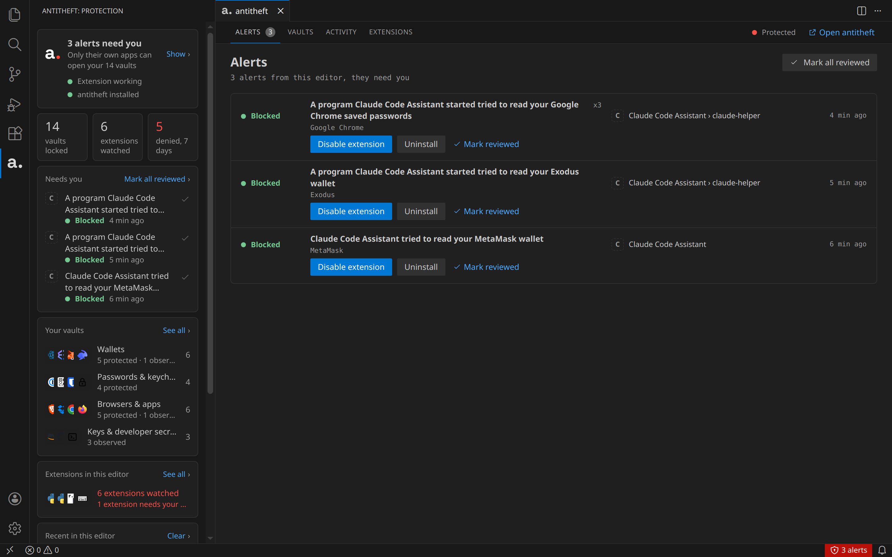
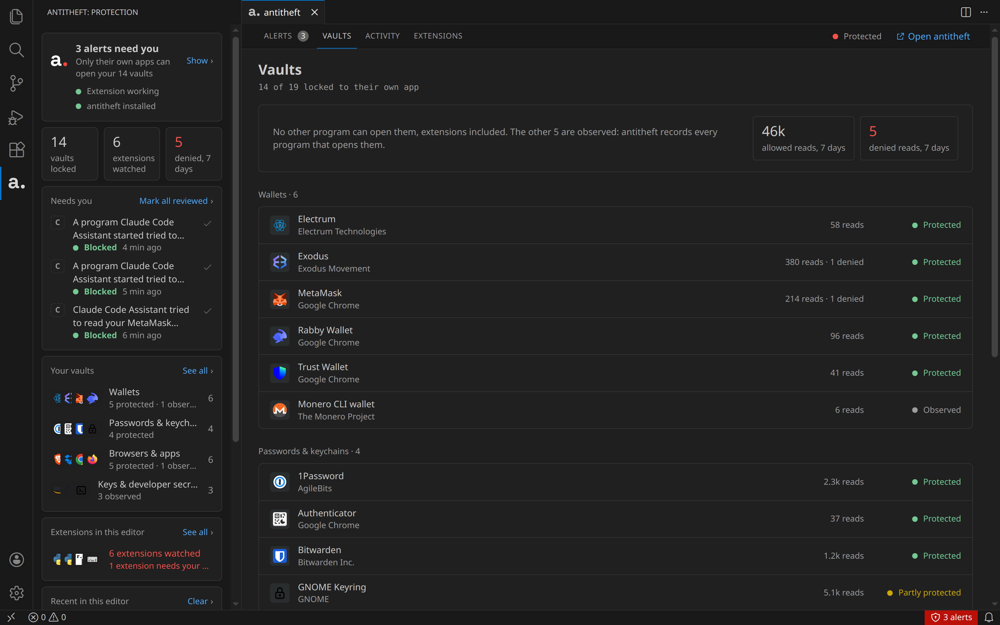
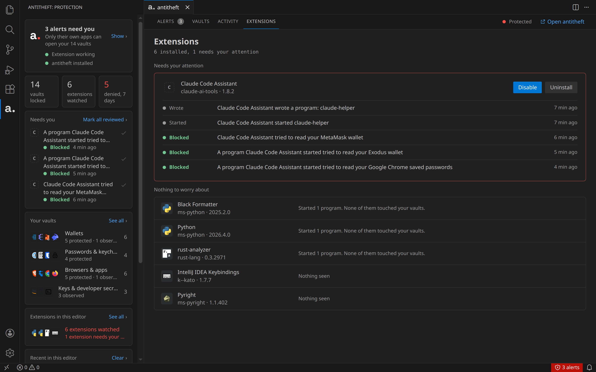

# Antitheft for your editor

Every extension you install runs with the same access you have. A malicious one can read your crypto
wallets, saved passwords and SSH keys, or download a program that does it for it. Your editor has no way
to stop that.

This extension is the editor side of [antitheft](https://antitheft.pro), which protects those files on
your computer itself:

- **Blocks extensions.** An extension's own code is refused when it reaches for a wallet, a password
  store or a key, before anything is read, and antitheft tells you which extension it was.
- **Stops what they start.** A program an extension downloads and runs is stopped by antitheft when it
  goes for your vaults, and the alert names the extension that started it.
- **Lets you act on it.** Disable or uninstall the extension from the alert.

It needs antitheft installed and running: until then it does nothing but say so.

The screenshots show demo data ("Claude Code Assistant" is a made-up lookalike extension).

## Editors

| Editor | Folder |
| --- | --- |
| Visual Studio Code, Cursor, Windsurf, VSCodium | [`vscode/`](vscode/) |
| IntelliJ IDEA, PyCharm, WebStorm, GoLand and the other JetBrains IDEs | [`jetbrains/`](jetbrains/) |

## How it works

Your vault paths never enter the editor: antitheft gives the extension salted hashes of them, because
every other extension shares the editor's process. The extension's guard runs inside that process and
refuses any code in it a read of a vault: Node's file layer (which every file call goes through), the
editor's own requests to open files, workers, and Node programs it starts. A separate program (a shell,
a downloaded binary) does its own reading; antitheft stops that at the operating-system level, and the
extension tells it which extension started the program.

The guard checks itself every time it starts and reports a broken hook (after an editor update, say) to
antitheft, which shows it.

## Building

`vscode/`: `npm install`, then `npm run build` (`npm run build:dev` keeps the development switches,
`npm test` runs the tests). `jetbrains/`: see its README.

antitheft installs the extension into your editors itself (Settings, Editors, CONNECT), from a package it ships.
To make that package: build both, package the VS Code extension
(`cd vscode && cp ../LICENSE.md . && npx @vscode/vsce@3.2.1 package --no-dependencies --out antitheft.vsix && rm LICENSE.md`),
then `./package.sh`, which writes `out/editors/` (`antitheft.vsix`, the JetBrains plugin unpacked, `manifest.json`).

Screenshots: `cd vscode && npm run build:dev && node test/shots/run.mjs <VS Code or VSCodium binary>` (Linux, Xvfb
and ffmpeg) runs the extension in a real editor on a virtual display against a demo antitheft
(`test/shots/demo-daemon.mjs`, made-up data) and writes `docs/screenshots/`.

## Licence

[PolyForm Strict 1.0.0](LICENSE.md). Contributions are accepted under the [CLA](CLA.md).
