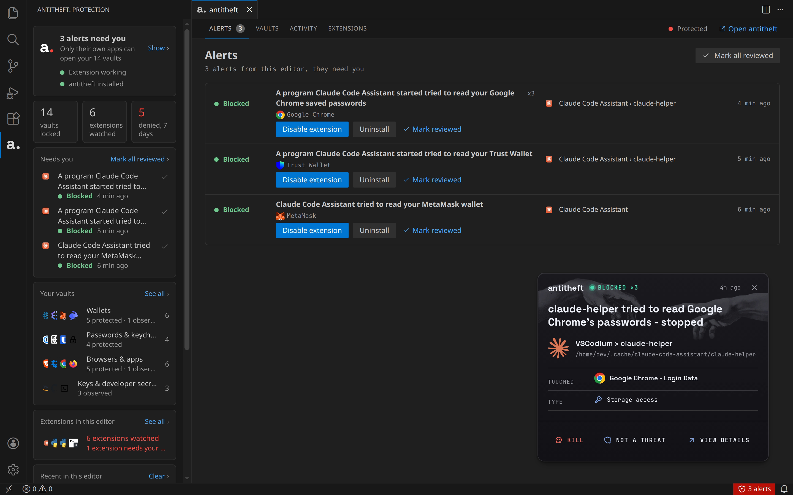

# Antitheft

**Stop infostealers in extensions, AI agents and the programs they start from stealing your wallets and passwords, and see who opens your secrets.**

Every extension you install, every AI agent you let run commands, and every script your editor starts runs
with the same access you have. One bad update, one poisoned package or one prompt injection is enough to
read your wallet, the passwords your browser saved, or the session that keeps you signed in, and send them
away. Your editor does not stop it, and it does not tell you what did it.

Antitheft does both. It works with the [Antitheft app](https://antitheft.pro), which keeps your vaults for their own
apps on the computer itself (other programs are stopped, and on Linux refused before the file opens), and
this extension brings that protection inside the editor.

## What it does

- **Blocks extensions from your vaults.** When an extension's code reaches for a wallet, a password store or
  a browser's saved logins, the read is refused before anything is opened.
- **Stops what they start.** If an extension downloads a program and runs it, Antitheft stops that program
  when it goes for your vaults.
- **Covers AI agents and everything the editor runs.** Coding agents and assistants, the terminal, tasks,
  MCP servers and the install scripts of the packages you add are kept from your vaults the same way, and the
  alert shows where it came from, like "Claude Code › rm".
- **Names who did it.** Every alert says which extension or program was behind it, and an extension can be
  disabled or uninstalled right from the alert.
- **Shows you what is protected.** The Vaults tab lists the wallets, password managers and browsers Antitheft
  found on your computer, and which ones are kept for their own app.
- **Keeps an eye on every extension.** The Extensions tab shows what each installed extension did: the
  programs it started or wrote, and whether any of it touched your vaults.

## Supported vaults

Antitheft keeps each of these for its own app. An extension, an AI agent or a program either of them starts
that reaches for one is stopped; on Linux the read is refused before the file opens. Names without a note are
supported on Linux, macOS and Windows.

| Vault | Apps |
| --- | --- |
| Browsers: saved passwords, cookies (your signed-in sessions), cards | Google Chrome (also Beta and Dev), Chromium, Brave, Microsoft Edge, Opera, Vivaldi, Yandex Browser, Firefox, LibreWolf, Waterfox, Arc (macOS, Windows), ungoogled-chromium (Linux) |
| Wallet browser extensions | MetaMask, Phantom, Rabby, Trust Wallet, Coinbase Wallet, OKX Wallet, Binance Wallet, Bitget Wallet, Keplr, Backpack, Ronin, SubWallet, Talisman, Core, Enkrypt, Magic Eden and 20 more, plus any other extension that describes itself as a crypto wallet, in every browser above |
| Desktop wallets | Exodus, Atomic Wallet, Ledger Live, Electrum, Electrum-LTC, Electron Cash, Dash Electrum, Sparrow, Wasabi, Bisq, Feather, Guarda, Monero GUI and Monero wallet files, Coinomi (macOS, Windows), BlueWallet (macOS) |
| Password managers | 1Password, Bitwarden (app and CLI), Keeper, NordPass, Proton Pass, Enpass, Dashlane (Linux), LastPass, RoboForm and Sticky Password (macOS, Windows), KeePassXC and KeePass (their settings and browser connection) |
| 2FA apps and extensions | Authy, Ente Auth, 2fa, Proton Authenticator, GNOME Authenticator and Keysmith (Linux), Yubico Authenticator (macOS, Windows), WinAuth (Windows), and authenticator extensions such as 2FAS and Authenticator |
| System keychains | macOS Keychain, GNOME Keyring and KDE Wallet (Linux) |
| Messaging | Discord, Slack, Signal, Element, Telegram (macOS, Windows) |
| Cloud sync | Dropbox, MEGA, Nextcloud, pCloud, rclone, Syncthing |
| Email logins | Thunderbird (Linux, macOS), Canary Mail (macOS, Windows) |
| Notes apps | Joplin, Standard Notes, Obsidian and Logseq (app settings and plugins) |
| Remote connections | Termius, Remmina (Linux), mRemoteNG and Xshell (Windows) |
| Game launchers | Steam (macOS, Windows), Battle.net, EA app, GOG Galaxy, Riot Client, Rockstar Games Launcher, Ubisoft Connect (Windows) |

### Developer secrets

Your build tools, deploy scripts, agents and CLIs read these all day, so Antitheft does not stop anyone reading
them: it records every program that opens one, and you see who it was. The Vaults tab marks each one Observed,
with its reads this week, and the Antitheft app shows which program read it.

| Secret | Tools |
| --- | --- |
| Project secrets | `.env` files in your projects |
| SSH | Private keys, `~/.ssh/config`, `known_hosts`, `authorized_keys`, ssh-agent, PuTTY, sshPilot, saved sites in FileZilla, WinSCP, MobaXterm, Cyberduck. Turn on **SSH key hardening** in the Antitheft app's settings and only SSH tools can read your keys |
| Cloud | AWS CLI, Google Cloud CLI, Azure CLI, DigitalOcean, Cloudflare Wrangler, Vercel, Netlify, Fly.io, Heroku, Railway, Render, Firebase, Supabase |
| Infrastructure | kubectl, Helm, Terraform, Pulumi, Vagrant, Ansible Vault, Docker and Podman registry logins |
| Secret managers | HashiCorp Vault, Doppler, Infisical, 1Password CLI (the Bitwarden CLI is protected, see above) |
| Code hosting and CI | GitHub CLI, GitLab CLI, Git credential stores and Git Credential Manager, `.netrc`, GitLab Runner, Buildkite, CircleCI, TeamCity |
| Package registry tokens | npm, PyPI, Cargo, RubyGems, NuGet, Maven, Gradle, Composer |
| Databases | `.pgpass`, `.my.cnf`, pgAdmin, DBeaver, MongoDB Shell and Compass, redis-cli |
| Signing keys | GnuPG, `pass`, Android and Java keystores |
| Command-line wallets | Bitcoin Core, geth, Foundry, Hardhat, Truffle, Solana CLI, Anchor, Sui, NEAR, Aptos, TRON wallet-cli, Monero CLI |

Also recorded: other email apps, backup tools (Borg, Kopia, Vorta) and game launchers on Linux.

KeePass and KeePassXC databases (`.kdbx`) are not covered, because they live wherever you choose to save
them.

What Antitheft finds and protects on your computer depends on the apps you have installed. The Vaults tab
shows exactly what it is protecting on yours.

## In the editor

- **Sidebar.** Your protection at a glance: whether Antitheft is running, how many vaults are protected, how
  many extensions are watched, and anything that needs you.
- **Alerts.** What was blocked or stopped, which extension was behind it, and the program it used. Mark an
  alert reviewed, or open it in the Antitheft app for the full story.
- **Vaults, Activity, Extensions.** Everything Antitheft knows about this editor, in the editor's own theme.
- **Status bar.** Shows when an alert needs you and takes you straight to it.

## Requirements

- The [Antitheft app](https://antitheft.pro), installed and running on the same computer. Without it the
  extension only tells you so and does nothing else.
- Visual Studio Code, Cursor, VSCodium or Antigravity, on Linux, macOS or Windows. For IntelliJ IDEA,
  PyCharm and the other JetBrains IDEs, there is an Antitheft plugin as well.

The Antitheft app can install this extension into your editors for you: Settings, Editors, Connect.

## Your data stays on your computer

The extension talks only to Antitheft on your own computer. It sends nothing anywhere else, and it does not
need to know where your vaults are to protect them.

## Commands

Open the command palette and type **Antitheft**:

| Command | What it does |
| --- | --- |
| Antitheft: Show alerts | Opens the alerts that need you |
| Antitheft: Show vaults | Lists the vaults on this computer |
| Antitheft: Show activity | What extensions did in this editor |
| Antitheft: Show extensions | Every installed extension and what it did |
| Antitheft: Open the Antitheft app | Brings the Antitheft app forward |
| Antitheft: Check protection again | Looks for Antitheft again, for example after you start it |

## Source and issues

The extension's code is on GitHub: [kinnector/antitheft-extension](https://github.com/kinnector/antitheft-extension). Report a problem or ask a question in
[its issues](https://github.com/kinnector/antitheft-extension/issues).

The screenshots show demo data: the "Claude Code Assistant" extension in them is made up, and stands for the
lookalike extensions that copy a popular name to get installed.

## Licence

PolyForm Strict 1.0.0, in `LICENSE.md` with the extension. Made by kinnector, [antitheft.pro](https://antitheft.pro).
