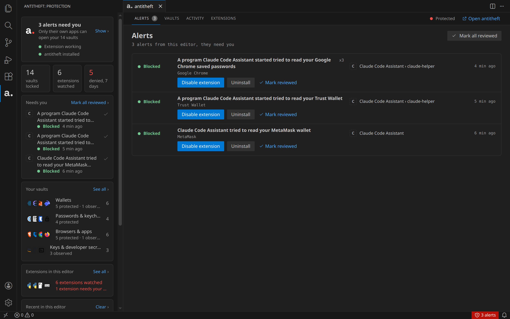
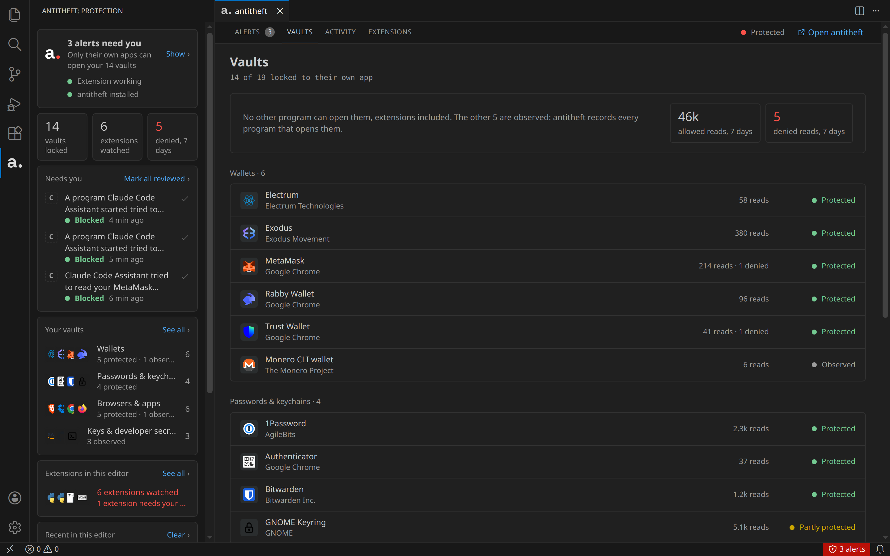
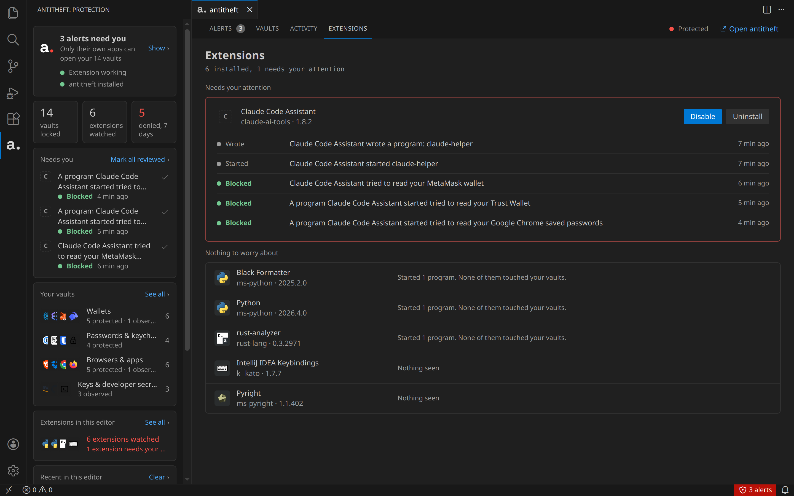

# Antitheft

**Stop malicious extensions, AI agents and the programs they start from stealing your crypto wallets and passwords.**

Every extension you install, every AI agent you let run commands, and every script your editor starts runs
with the same access you have. One bad update, one poisoned package or one prompt injection is enough to
read your wallet, the passwords your browser saved, or the session that keeps you signed in, and send them
away. Your editor does not stop it, and it does not tell you what did it.

Antitheft does both. It works with the [Antitheft app](https://antitheft.pro), which locks your vaults on the
computer itself, and this extension brings that protection inside the editor.

## What it does

- **Blocks extensions from your vaults.** When an extension's code reaches for a wallet, a password store or
  a browser's saved logins, the read is refused before anything is opened.
- **Stops what they start.** If an extension downloads a program and runs it, Antitheft stops that program
  when it goes for your vaults.
- **Covers AI agents and everything the editor runs.** Coding agents and assistants, the terminal, tasks,
  MCP servers and the install scripts of the packages you add are refused your vaults the same way, and the
  alert shows where it came from, like "Claude Code › rm".
- **Names who did it.** Every alert says which extension or program was behind it, and an extension can be
  disabled or uninstalled right from the alert.
- **Shows you what is protected.** The Vaults tab lists the wallets, password managers and browsers Antitheft
  found on your computer, and which ones only their own app can open.
- **Keeps an eye on every extension.** The Extensions tab shows what each installed extension did: the
  programs it started or wrote, and whether any of it touched your vaults.

## What it protects

Antitheft locks a vault to its own app: only that app can open it, and anything else is refused. That
covers:

- crypto wallets, desktop apps and browser extension wallets alike
- the passwords, cookies and cards your browsers saved
- password managers and authenticator (2FA) apps
- your desktop keyring
- messaging and cloud sync logins

Developer files such as `.env`, cloud CLI credentials and SSH keys are watched by the Antitheft app, which
records every program that opens them.

What Antitheft finds and locks depends on the apps installed on your computer and on your system. The
Vaults tab shows exactly what it is protecting on yours.

## In the editor

- **Sidebar.** Your protection at a glance: whether Antitheft is running, how many vaults are locked, how
  many extensions are watched, and anything that needs you.
- **Alerts.** What was blocked or stopped, which extension was behind it, and the program it used. Mark an
  alert reviewed, or open it in the Antitheft app for the full story.
- **Vaults, Activity, Extensions.** Everything Antitheft knows about this editor, in the editor's own theme.
- **Status bar.** Shows when an alert needs you and takes you straight to it.

## Requirements

- The [Antitheft app](https://antitheft.pro), installed and running on the same computer. Without it the
  extension only tells you so and does nothing else.
- Visual Studio Code, Cursor, VSCodium or Antigravity, on Linux, macOS or Windows. For IntelliJ IDEA,
  PyCharm and the other JetBrains IDEs, there is an Antitheft plugin as well.

The Antitheft app can install this extension into your editors for you: Settings, Editors, Connect.

## Your data stays on your computer

The extension talks only to Antitheft on your own computer. It sends nothing anywhere else, and it does not
need to know where your vaults are to protect them.

## Commands

Open the command palette and type **Antitheft**:

| Command | What it does |
| --- | --- |
| Antitheft: Show alerts | Opens the alerts that need you |
| Antitheft: Show vaults | Lists the vaults on this computer |
| Antitheft: Show activity | What extensions did in this editor |
| Antitheft: Show extensions | Every installed extension and what it did |
| Antitheft: Open the Antitheft app | Brings the Antitheft app forward |
| Antitheft: Check protection again | Looks for Antitheft again, for example after you start it |

## Source and issues

The extension's code is on GitHub: [kinnector/antitheft-extension](https://github.com/kinnector/antitheft-extension). Report a problem or ask a question in
[its issues](https://github.com/kinnector/antitheft-extension/issues).

The screenshots show demo data: the "Claude Code Assistant" extension in them is made up, and stands for the
lookalike extensions that copy a popular name to get installed.

## Licence

PolyForm Strict 1.0.0, in `LICENSE.md` with the extension. Made by kinnector, [antitheft.pro](https://antitheft.pro).
